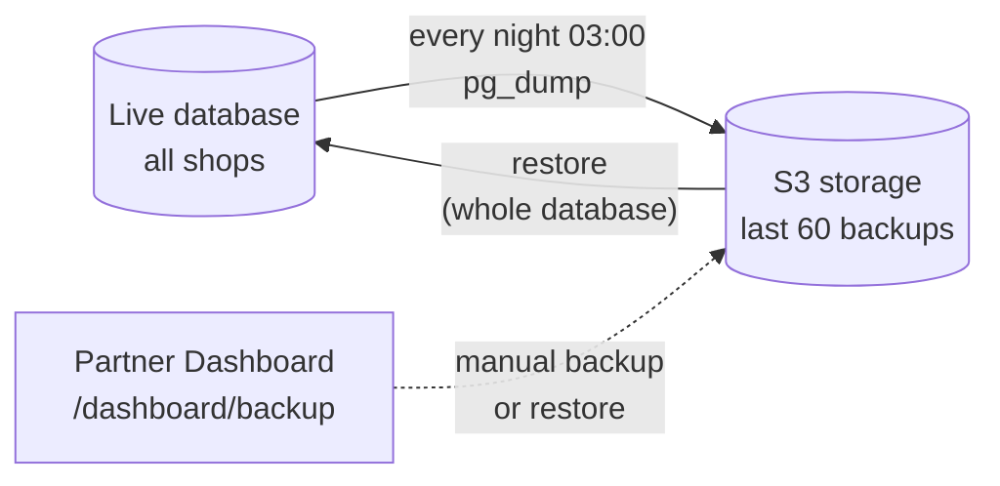

# custom-shafts

Two screens. Chapter 1 is the shop’s custom-shaft order. Chapter 2 is the clinical shoe order (Massschuhauftrag).

| Section | What is in it |
| ------- | ------------- |
| 1.1 | Catalogue page. The screen itself is fine. How the list is loaded is in 1.8. |
| 1.2 | Start popup. A physical last asks for shipping before the order form opens. |
| 1.3 | Order form. Customer name, child orders, last or 3D, shipping, leather, and dropdowns. |
| 1.4 | Balance activity. The list was built for money, and a draft cannot be deleted. |
| 1.5 | Nightly database backup. What it saves, and what it misses. |
| 1.6 | Production number. Two different orders can get the same number. |
| 1.7 | Shared lists. Colour card, catalogue, soles, frames, days, holidays, shipping prices. These should come from Redis. |
| 1.8 | Catalogue and order form. The same data is kept in too many places, so the screen shows old data. |
| 1.9 | Leather on a catalogue product. Hard to open from the product list. The shop’s auto-fill does not show what will be copied. |
| 1.10 | Zipper drawing. The shop marks the place, but chain type and colour are not on the screen and are not stored. |
| 1.11 | Finish dialog. Switch between upper and floor. A 3D order must warn that the floor cannot be configured. |
| 2.1 | Clinical overview. The header and the two progress numbers do not match. |
| 2.2 | Konfiguratoren cards. Too small for the data on them. |
| 2.3 | Leisten drawer. The layout is fine. The saved data can be stale. |
| 2.4 | Halbprobe modal. The feedback is hard to read. |
| 2.5 | Page state. Old data stays on screen until reload. |
| 2.6 | Saving a part. Duplicates, two tables that disagree, whole order confirmed, barcode with no login. |
| 2.6.1 | Leaving the page. “No, delete” removes the whole supply. |
| 2.7 | Voice recording. Browser speech works in Chrome and Edge only. |

---

# Chapter 1: Custom shafts

Route: `/dashboard/custom-shafts`

## 1.1 Catalogue page

The shoe catalogue screen looks fine. How the list is loaded is in 1.8.

The page is good: clear, easy to use, and everything the shop needs is on one screen.

## 1.2 Start popup asks for shipping too early

The first popup, before the order form. It should only ask how production starts.

With **3D-Modell hochladen** the popup is easy: one click and the order form opens.

With **Physischer Leisten** the popup keeps going and asks for the shipping of the last (combined shipment, label, pickup, date, address) before the shop even sees the order. This is the wrong place. The shipping choice should move into the order page itself, for example as a sidebar, so the popup only asks how production starts.

In my opinion, this needs to be a bit easier.

## 1.3 Order form

The form after the popup. Six separate points. Each one has its own heading below.

### 1.3.1 The customer box shows an id

The customer box shows the id (`cmr0na6ef000bdzvwcd1vpbnl`), not a person. A name is required. If there is no name, show the address. The id stays in the database and is not shown in the box.

The customer is stored as first name (`vorname`) and last name (`nachname`). One **name** field is enough. The shop types one name.

### 1.3.2 A follow-up order must reuse the customer

When there is no real customer, the next order in the chain must not ask for a customer id or a name again. Halbprobe, then Massschuh, then Boden. Each child order uses the previous order’s answer.

### 1.3.3 Physical last or 3D cannot be changed here

The choice "physical last or 3D" is made in the popup and cannot be changed on this page. If the shop changes its mind, it has to go back and start again. We suggest letting the shop switch between physical last and 3D directly on this page.

### 1.3.4 Shipping belongs on this page

Shipping should be managed from this page, not in the start popup. While **Show prices** is off (during the customer consultation), the shipping part stays hidden. The shop can open the order again later and edit the shipping there.

### 1.3.5 Leather areas are hard to fill

This step can feel complicated for a normal partner. We suggest making it simpler.

### 1.3.6 In English, a dropdown shows every choice at once

In English, and in every language other than German, a dropdown does not open as a list. Every choice is drawn side by side inside the closed field. The shop cannot see one selected value. This is not only CAD modeling. Closure, leather, and the other fields on this form do the same.

A dropdown must show the one selected value. The other choices appear only when the field is opened, one under the other.

## 1.4 Balance activity list

The activity page. It tracks orders, but the logic was written for transactions.

The page itself is fine. We suggest rebuilding the logic around the order:

- Clicking an order opens its details.
- The shop can edit an order until the admin confirms it.
- Shipping is managed in a sidebar: cancel a FedEx label, add or remove a shipment group.

These changes can be added easily.

Personally, I do not like the design of this page. We need to improve its UI/UX.

### 1.4.1 A draft cannot be deleted

A shop can cancel an order only after it is sent ("Order received"). A draft has no delete option, so drafts the shop does not need stay in the list. We suggest letting the shop delete its own drafts, and restore them later if needed, the same way the admin can restore orders from the Trash.

## 1.5 The database is backed up once a night

A full copy of the live database. One dump at 03:00. The last 60 copies are kept.

| | |
| --- | --- |
| When | Every day at 03:00 morning in Germany time |
| How | `pg_dump` of the whole database, uploaded to S3 |
| Kept | The last 60 backups (about 2 months) |
| Manual backup and restore | Partner Dashboard, `/dashboard/backup`. A restore first takes a safety snapshot, then replaces the live database. |

**What can go wrong**

- If a backup fails, there is no notification. Nobody learns about it.
- The whole day's work is backed up once, at 03:00 at night. For example: a shop creates a draft order and deletes it one hour later. That order cannot be recovered, because it never reached a backup.
- Data older than 60 days can no longer be restored.

## 1.6 Two orders can share one production number

The factory number is not the full order number. It is the shop prefix plus the last 3 digits.

The production number is the shop prefix plus the last 3 digits of the order number (`buildProductionNumber`). The full order number is not kept.

| Order number | Prefix AB |
| ------------ | --------- |
| 10100        | AB100     |
| 11100        | AB100     |

Both end in `100`, so both become `AB100`. The same shop gets the same production number again every 1000 orders (`10000` and `11000` are both `AB000`). `production_number` has no unique rule, so two orders can share it. A search or a factory sheet can then open the wrong order.

## 1.7 Shared lists should come from Redis

Lists that are the same for every shop. The colour card is one of them. Opening it searches the database today.

The color card is the same list for every shop. It should come from Redis. The database is only for when an admin adds or changes a color.

These tables are the same kind. They do not change per order.

| What the shop sees | Table |
| --- | --- |
| Color card | `leather_type`, `Leather_color` (in `reference-shoe.schma.prisma`) |
| Shoe catalogue | `maßschaft_kollektion` |
| Sole list | `sole_item` |
| Frame list | `frame_item` |
| Working days and production cost | `custom_shafts_delivery_dates` |
| Holidays | `holyday_and_vacation` |
| Shipping prices | `shipping_pricing` |

Orders stay on the database: `custom_shafts`, files, status history, feedback, invoices, shipping, chat, and `custom_models`. A shop’s own favourites stay there too.

When an admin edits one of these lists, the backend saves the database and refreshes that Redis key. The shop screen reads Redis only.

## 1.8 Catalogue and order form show old data

Routes: `/dashboard/custom-shafts` and `/dashboard/custom-shafts/details/[id]`.

The screens work. The same list and the same order are loaded in more than one place, so a filter, a reload, or a save can show old data until the page is opened again. This is the same kind of problem as Clinical Assistant (2.5).

**Catalogue** (`custom-shafts/page.tsx`)

`useCustomShafts` fetches inside `useEffect` and keeps the answer in `useState`. The page copies that answer into a second list, `allFetchedItems`, and filters it again. The API already filtered it.

**Mehr anzeigen**, and a notification that should open one model, do not ask for that model. They raise `currentPage` until the model appears. A change of gender, category, or search clears the list and starts again at page 1.

**Order form** (`custom-shafts/details/[id]/page.tsx`)

Each field is its own `useState`. The same order is also kept in three other places:

| Place | What it keeps |
| --- | --- |
| URL | customer, draft flag, and every shipping field |
| `localStorage` / `sessionStorage` | the form draft (`customShaftsOrderFlowDraftStorage`) |
| `CustomShaftDataContext` | a third copy, passed on to Bodenkonstruktion |

Customer data is filled from the URL, from the linked Massschuh order, and from `getParentOrderInfo`. Those three can overwrite each other.

The model is loaded by `useSingleCustomShaft`, another `useEffect` with no cache. Opening the same model again fetches it again.

The same form is copied in `custom-shafts/product-order/[id]/page.tsx`. A fix on the details page leaves the other page old.

**What goes wrong**

- The list and the "load more" counter can disagree, so the page walks the next API page while the shop waits.
- A filter always starts from page 1, even for a list the shop just had.
- After a reload, the form can be a mix of the URL, `localStorage`, and the server draft.
- Shipping lives in the URL, so the details page cannot treat it as normal order data.
- A save updates the context, the URL, and the draft storage by hand. Miss one of them and Boden or Balance shows the old order.

**What to use**

TanStack Query for server data. One cache key, shared by the catalogue, the details page, and the product-order page.

| Data | Query key |
| --- | --- |
| Catalogue pages | `['custom-shafts', { search, gender, category, sort }]` |
| One model | `['custom-shaft', shaftId]` |
| The order or draft | `['custom-shaft-order', orderId]` |
| Other shoe orders for this customer | `['sync-orders', customerId, 'Massschafterstellung']` |

Zustand for the form while the shop is typing. One object, not one `useState` per field. `localStorage` is only a backup if the tab closes. The URL keeps only the model id, the order id, and the customer id. Shipping and measurements stay on the order.

Save draft or send order refreshes `custom-shaft-order`. Details, Boden, and Balance then read the same key. Do this before more UI work on the popup and the leather step.

## 1.9 Leather on a catalogue product is hard to edit

The admin product list and the leather map are two different pages. The shop never sees that map when it takes the catalogue finish.

**Product list:** `/dashboard/upload-product`

The list shows name, price, height, and gender. The pencil opens the whole product form at `/dashboard/add-products?id=...`. The leather map is buried inside that form.

**Leather map:** Ledertyp, colour name, and the areas painted on the shoe picture.

There is no way to open this map from the product list. To change one area, the admin has to open the full product and find this step. The list should open this map, and the admin should edit it from there.

**When the shop takes the catalogue finish**

On the order form the shop presses **Ausführung wie im Katalog**. The dialog only asks if Material & Ausführung should be filled from the saved data. It does not show the leather types, the colours, or the areas.

The dialog should show what will be copied, so the shop sees what this product actually has before pressing OK. That is the same leather map from the admin product.

## 1.10 The zipper screen does not ask for chain type or colour

The zipper modal on the order form (`ZipperPlacementModal`). The shop picks a side and draws on the shoe.

What is saved today:

| On the screen | Stored as |
| --- | --- |
| Inside, Outside, or Both sides | `zipper_position` |
| The red drawing | `zipper_image` |
| Extra zipper, yes or no, with a price | `zipper_extra` on the order JSON |

Chain type and zipper colour are not on this screen. They are also not in the database. `maßschaft_kollektion` only has `is_zipper` (yes or no). `custom_shafts` only has `zipper_image`.

A shoe zipper is ordered by chain type and colour, not only by where it sits. Chain type is coil or metal. Colour is the tape colour. Those two should be on this screen, next to the position, so the factory sees them with the drawing.

## 1.11 After the upper is done, switch to the floor and back

The dialog when the upper (Schaft) is finished (`ConfirmationModal`). It shows the customer, the product, **Further without a bottom**, and **Configure floor**.

From here the shop should move between the upper and the floor in both directions. Upper to floor, and floor back to upper. Today **Configure floor** leaves the upper, and there is no matching way back.

**A 3D order cannot configure the floor.** The green **Configure floor** button still looks like a normal next step. The block appears only after the click, as a second popup: “Bestellung nicht möglich.” The warning belongs on this dialog, before the click, and **Configure floor** should not look available. **Further without a bottom** stays the way to finish a 3D order.

---

# Chapter 2: Clinical Assistant (Masschuhauftrag)

Route: `/dashboard/scanning-data/[id]?form=clinical_assistant`

The shop builds one custom shoe here, step by step: Befund, Versorgungsplan, Leisten, Bettung, Schaft, Boden, Halbprobe, Auftrag and Abholung.

The page often shows old data until it is reloaded. That is written in 2.5. What a save actually writes is in 2.6.

## 2.1 Overview: header and progress do not match

The first screen of the flow.

The flow is good, but the customer header shows dashes instead of real data, and the two progress numbers do not match ("1 von 2" here, "0 von 4" in Konfiguratoren). There are also too many buttons, so the next step is not clear.

## 2.2 Konfiguratoren cards are too small

The cards for each part of the shoe.

The cards are too small for the data they show (status, icons, employee, warnings, production type). We suggest a full-width list in the real workflow order: Leisten → Halbprobe → Schaft/Boden → Auftrag → Abholung.

## 2.3 Leisten drawer can show old data

The last (Leisten) form. The layout is fine. The data in it is the problem.

The UI here is fine. The work is in the code: we need better state management, so the data in the drawer always matches the order.

## 2.4 Halbprobe feedback is hard to read

The half-sample (Halbprobe) modal.

We need to improve the UI of this modal, so the feedback is clearer and easier to read.

## 2.5 The page keeps old data until reload

How the screen stores the order. Draft data (by customer) and order data (by order) are loaded in two different ways.

**What we use now:** only React `useState` and `useEffect` inside one very large component.

**What would be better:** TanStack Query for server data (cache per order, auto update after save) and Zustand for the page state (one store for the order). One store for the order, and the backend decides which steps are allowed.

The page often shows old data until reload. This is why the flow breaks after regular updates.

## 2.6 Saving one part writes the wrong data

The configurator on the clinical order. Four things change what is stored. The table under them is the full code list.

- The same part can be saved more than once. There is no rule “one last per order”, so a double click creates a second row. The page shows only one.
- Internal and FeetF1rst are saved in two tables. One can say FeetF1rst makes it, the other can say the shop makes it.
- Saving one part confirms the whole supply. The shop does not have to press the signature buttons.
- The barcode link does not need a login. Whoever has the link can add a scan to that order. Anyone can write a scan there without proving who they are (`GET /v4/clinical_assistant/order_components/barcode-scan`).

**Where in the code**

| # | What happens | Where |
| --- | --- | --- |
| 1 | `getOrderComponents` is called from 9 places, once per part and again after every save | `components/clinical/ComponentConfigurator.tsx` (lines 733–1078) |
| 2 | Leisten form is read every 400 ms while open | `ComponentConfigurator.tsx:1232` (`setInterval(tick, 400)`) |
| 3 | Three files with more than 3000 lines each | `ComponentConfigurator.tsx` (3294), `CarePlan.tsx` (3083), `ClinicalAssistant.tsx` (3837) |
| 4 | No chat with FeetF1rst on External cards; the shop must open the Balance page | `ComponentConfigurator.tsx` |
| 5 | Live update (`shoe-order-steps`) is sent only from the QR / barcode link | backend `order_sheet.controllers.ts:105` |
| 6 | On a live update, only the step list reloads, not the cards | `CarePlan.tsx:698` |
| 7 | Saving a part confirms the whole order (`order_conform`) without the signature buttons | backend `order_components.controllers.ts:1633` (`markShoeOrderConform`) |
| 8 | No unique rule for one part per order, so a double click can create the same part twice | schema `clinica_assistant_order_components` (no `@@unique([shoe_order_id, catagory])`) |
| 9 | Same for active parts: duplicate rows possible | schema `active_components` (no `@@unique([shoe_order_id, catagory])`) |
| 10 | Internal / External is saved in 2 tables that can disagree | `clinica_assistant_order_components.component_type` and `active_components.component_type` |
| 11 | The barcode link has no login, so anyone with the link can write a scan on that order | `order_components.routes.ts` (`GET /barcode-scan`, no `verifyUser`) |

### 2.6.1 “No, delete” removes the whole supply

The popup when the shop leaves the page. The red button does not only throw away a draft.

- "Draft" only means "order not confirmed". Parts are not checked, so a supply with a running FeetF1rst order is still called a draft.
- **"Nein, löschen" deletes the whole supply** (findings, signature, insurance, notes, history and more). No undo, no trash. A running FeetF1rst order is not cancelled, only unlinked.
- Confusing buttons: question "keep?", red button "No, delete".
- Not shown on tab close or reload. If the check fails, the page just leaves.

## 2.7 Voice recording works only in some browsers

Klinische Denkstruktur, button **Gespräch aufnehmen**.

For **Gespräch aufnehmen** we use the free speech recognition that is built into the browser. It works well in Chrome and Edge, but not in every browser (for example Firefox), so some shops cannot use it.

If we want voice to work in every browser, we need a better solution: record the audio in the browser and send it to a speech-to-text service on our server (for example OpenAI Whisper, Deepgram or Azure Speech). This works the same in all browsers, gives better results for German medical words, but it has a cost per minute.
