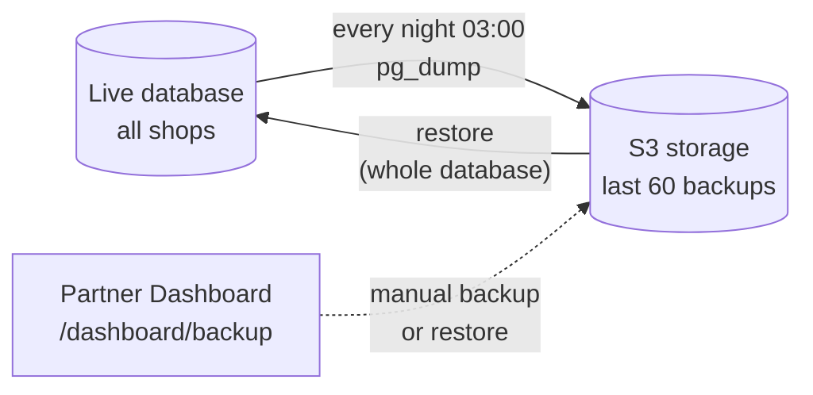
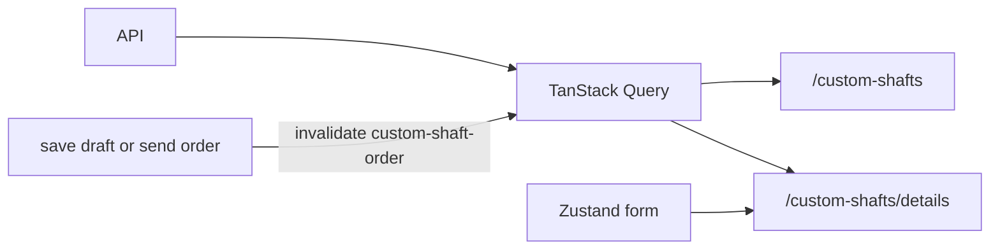

# custom-shafts

| Chapter | Topic                                | Route                                                   |
| ------- | ------------------------------------ | ------------------------------------------------------- |
| 1       | Custom shafts                        | `/dashboard/custom-shafts`                              |
| 2       | Clinical Assistant (Masschuhauftrag) | `/dashboard/scanning-data/[id]?form=clinical_assistant` |

---

# Chapter 1: Custom shafts

## 1.1 Catalogue page


The page is good: clear, easy to use, and everything the shop needs is on one screen.

## 1.2 Popup: how production starts


With **3D-Modell hochladen** the popup is easy: one click and the order form opens.

With **Physischer Leisten** the popup keeps going and asks for the shipping of the last (combined shipment, label, pickup, date, address) before the shop even sees the order. This is the wrong place. The shipping choice should move into the order page itself, for example as a sidebar, so the popup only asks how production starts.

In my opinion, this needs to be a bit easier.

## 1.3 Order form


The choice "physical last or 3D" is made in the popup and cannot be changed here. If the shop changes its mind, it has to go back and start again. We suggest letting the shop switch between physical last and 3D directly on this page.

Shipping should also be managed from this page, not at the start. While **Show prices** is off (during the customer consultation), the shipping part stays hidden. The shop can open the order again later and edit the shipping there.


This step can feel complicated for a normal partner. We suggest making it simpler.

## 1.4 Balance page: activity


The page itself is fine. But the logic behind it was built for transactions, and today it is used to track orders. We suggest rebuilding it around the order:

- Clicking an order opens its details.
- The shop can edit an order until the admin confirms it.
- Shipping is managed in a sidebar: cancel a FedEx label, add or remove a shipment group.

These changes can be added easily.

**Drafts cannot be deleted**


A shop can cancel an order only after it is sent ("Order received"). A draft has no delete option, so drafts the shop does not need stay in the list. We suggest letting the shop delete its own drafts, and restore them later if needed, the same way the admin can restore orders from the Trash.

Personally, I do not like the design of this page. We need to improve its UI/UX.

## 1.5 Database backup



**How it works**
image.png
| | |
| ------------------------- | ----------------------------------------------------------------------------------------------------------------- |
| When | Every day at 03:00 morning in Germany time |
| How | `pg_dump` of the whole database, uploaded to S3 |
| Kept | The last 60 backups (about 2 months) |
| Manual backup and restore | Partner Dashboard, `/dashboard/backup`. A restore first takes a safety snapshot, then replaces the live database. |

**Risk**

- If a backup fails, there is no notification. Nobody learns about it.
- The whole day's work is backed up once, at 03:00 at night. For example: a shop creates a draft order and deletes it one hour later. That order cannot be recovered, because it never reached a backup.
- Data older than 60 days can no longer be restored.

## 1.6 Code: catalogue and order form

Routes: `/dashboard/custom-shafts` and `/dashboard/custom-shafts/details/[id]`.

The screens work. The data behind them is loaded and saved in too many places, so a filter change, a reload, or a save often shows old data until the page is opened again. This is the same kind of problem as on the Clinical Assistant page.

### What we do now

**Catalogue** (`app/(dashboard)/dashboard/custom-shafts/page.tsx`)

The list does not use a query cache. `useCustomShafts` fetches inside `useEffect` and keeps the answer in `useState`. The page then copies that answer into a second list, `allFetchedItems`, and filters and sorts it again, even though the API already filtered and sorted it.

```ts
const { data: apiData, loading, error } = useCustomShafts(
  currentPage, itemsPerPage, debouncedSearchQuery, apiGender, apiCategory, sortPrice
);

useEffect(() => {
  if (!apiData?.data?.length) return;
  setAllFetchedItems((prev) => {
    if (currentPage === 1) return apiData.data;
    const existingIds = new Set(prev.map((item) => item.id));
    return [...prev, ...apiData.data.filter((item) => !existingIds.has(item.id))];
  });
}, [apiData?.data, currentPage]);
```

**Mehr anzeigen** and a notification deep-link do not ask for the model they need. They increase `currentPage` until the item shows up. A filter change throws the whole list away and starts again at page 1.

**Order form** (`app/(dashboard)/dashboard/custom-shafts/details/[id]/page.tsx`)

One page holds the whole order: customer, 3D files, leather, measurements, zipper, shipping and every modal. Each field is its own `useState`. The same order is also stored in three other places:

| Place | What it keeps |
| --- | --- |
| URL | customer, draft flag, and every shipping field (`shippingType`, `shippingPrice`, `deliveryMethod`, `lest_sending_type`, …) |
| `localStorage` / `sessionStorage` | the form draft, restored on reload through `customShaftsOrderFlowDraftStorage` |
| `CustomShaftDataContext` | a third copy, passed on to Bodenkonstruktion |

Customer data is filled by three effects that can overwrite each other: the URL, the linked Massschuh order, and `getParentOrderInfo` when the page is opened from feedback or a sample. Choosing a customer also calls `getSynchronousOrders` on its own and may open a modal.

```ts
const response = await getParentOrderInfo(sampleId || undefined, feedbackId || undefined);
```

The model itself is loaded by `useSingleCustomShaft`, which is another `useEffect` with no cache. Going back to the catalogue and opening the same model fetches it again.

The same form is copied in `custom-shafts/product-order/[id]/page.tsx`. A fix on the details page does not fix the other page.

### Issues we have now

- The catalogue list and the "load more" counter can disagree, so the shop waits while the page walks the next API page.
- Changing gender, category or search always refetches from page 1, even for a list we just had.
- After a reload, the form can come from the URL, from `localStorage`, or from the server draft. If those three do not match, the shop sees a mix.
- Shipping is decided in the popup and then carried in the URL. The details page cannot treat shipping as normal order data.
- A save does not refresh one shared order. The context, the URL and the draft storage are updated by hand. Miss one of them and the next page (Boden, Balance) shows the old order.
- Because the form is duplicated, the two routes drift apart after every change.

### What we should use

**TanStack Query for everything that comes from the server.** One cache key per request, shared by the catalogue, the details page and the product-order page.

| Data | Query key |
| --- | --- |
| Catalogue pages | `['custom-shafts', { search, gender, category, sort }]` as an infinite query |
| One model | `['custom-shaft', shaftId]` |
| The order or draft | `['custom-shaft-order', orderId]` |
| Other shoe orders for this customer | `['sync-orders', customerId, 'Massschafterstellung']` |

**Zustand for the form while the shop is typing.** One object for the order fields, not one `useState` per field. `localStorage` stays only as a backup of that object if the tab closes. It is not a second source next to the URL.

The URL should keep only what identifies the page: model id, order id, customer id. Shipping and measurements stay in the order query.

### Why the data will be on time



- **Mehr anzeigen** reads the next page of the infinite query. Pages already loaded stay in the cache, so a filter the shop just used does not start from zero.
- Clicking a model prefetches `['custom-shaft', shaftId]`. The details page opens with the model already there.
- Save draft or send order invalidates `['custom-shaft-order', orderId]`. Details, Boden and Balance read that same key, so they update together.
- Customer, 3D files and parent order come from that one order query. The three effects that overwrite each other go away.
- `product-order` uses the same query and the same form store, so the two routes cannot drift.

Do this before more UI work on the popup and the leather step. Once the order has one cache key, moving shipping onto the details page is a normal field change, not another set of URL parameters.

## 1.7 Production number is not unique


The production number is the shop prefix plus the last 3 digits of the order number (`buildProductionNumber`). The full order number is not kept.

| Order number | Prefix AB |
| --- | --- |
| 10100 | AB100 |
| 11100 | AB100 |

Both end in `100`, so both become `AB100`. The same shop gets the same production number again every 1000 orders (`10000` and `11000` are both `AB000`). `production_number` has no unique rule, so two orders can share it. A search or a factory sheet can then open the wrong order.

---

# Chapter 2: Clinical Assistant (Masschuhauftrag)

This is the page where the shop builds a custom shoe order for one customer, step by step: Befund, Versorgungsplan, Leisten, Bettung, Schaft, Boden, Halbprobe, Auftrag and Abholung.

The main issue on this page is state management. Because of the many regular updates, the page often shows old or wrong data until it is reloaded, and the flow between the steps breaks. We need to improve the state management in the code first, and then the UI.

**What we use now:** only React `useState` and `useEffect` inside one very large component.

**What would be better:** TanStack Query for server data (cache per order, auto update after save) and Zustand for the page state (one store for the order).

## 2.1 Overview


The flow is good, but the customer header shows dashes instead of real data, and the two progress numbers do not match ("1 von 2" here, "0 von 4" in Konfiguratoren). There are also too many buttons, so the next step is not clear.

## 2.2 Konfiguratoren


The cards are too small for the data they show (status, icons, employee, warnings, production type). We suggest a full-width list in the real workflow order: Leisten → Halbprobe → Schaft/Boden → Auftrag → Abholung.

## 2.3 Leisten konfigurieren


The UI here is fine. The work is in the code: we need better state management, so the data in the drawer always matches the order.

## 2.4 Halbprobe and feedback


We need to improve the UI of this modal, so the feedback is clearer and easier to read.

## 2.5 State management

The page does not handle state well. Draft data (by customer) and order data (by order) are loaded in two different ways, and the page often shows old data until reload. This is why the flow breaks after regular updates. We suggest one store for the order and letting the backend decide which steps are allowed.

## 2.6 Clinical order page: Configurators


Section 2.6 already lists the main problems. These three are the ones that change what is saved:

- The same part can be saved more than once. There is no rule “one last per order”, so a double click creates a second row. The page shows only one.
- Internal and FeetF1rst are saved in two tables. One can say FeetF1rst makes it, the other can say the shop makes it.
- Saving one part confirms the whole supply. The shop does not have to press the signature buttons.
- The barcode link does not need a login. Whoever has the link can add a scan to that order. Anyone can write a scan there without proving who they are (`GET /v4/clinical_assistant/order_components/barcode-scan`).

**Problems**

| #   | Problem                                                                                 | Where                                                                                      |
| --- | --------------------------------------------------------------------------------------- | ------------------------------------------------------------------------------------------ |
| 1   | `getOrderComponents` is called from 9 places, once per part and again after every save  | `components/clinical/ComponentConfigurator.tsx` (lines 733–1078)                           |
| 2   | Leisten form is read every 400 ms while open                                            | `ComponentConfigurator.tsx:1232` (`setInterval(tick, 400)`)                                |
| 3   | Three files with more than 3000 lines each                                              | `ComponentConfigurator.tsx` (3294), `CarePlan.tsx` (3083), `ClinicalAssistant.tsx` (3837)  |
| 4   | No chat with FeetF1rst on External cards; the shop must open the Balance page           | `ComponentConfigurator.tsx`                                                                |
| 5   | Live update (`shoe-order-steps`) is sent only from the QR / barcode link                | backend `order_sheet.controllers.ts:105`                                                   |
| 6   | On a live update, only the step list reloads, not the cards                             | `CarePlan.tsx:698`                                                                         |
| 7   | Saving a part confirms the whole order (`order_conform`) without the signature buttons  | backend `order_components.controllers.ts:1633` (`markShoeOrderConform`)                    |
| 8   | No unique rule for one part per order, so a double click can create the same part twice | schema `clinica_assistant_order_components` (no `@@unique([shoe_order_id, catagory])`)     |
| 9   | Same for active parts: duplicate rows possible                                          | schema `active_components` (no `@@unique([shoe_order_id, catagory])`)                      |
| 10  | Internal / External is saved in 2 tables that can disagree                              | `clinica_assistant_order_components.component_type` and `active_components.component_type` |
| 11  | The barcode link has no login, so anyone with the link can write a scan on that order  | `order_components.routes.ts` (`GET /barcode-scan`, no `verifyUser`)                        |

### 2.6.1 "Entwurf gespeichert" popup


- "Draft" only means "order not confirmed". Parts are not checked, so a supply with a running FeetF1rst order is still called a draft.
- **"Nein, löschen" deletes the whole supply** (findings, signature, insurance, notes, history and more). No undo, no trash. A running FeetF1rst order is not cancelled, only unlinked.
- Confusing buttons: question "keep?", red button "No, delete".
- Not shown on tab close or reload. If the check fails, the page just leaves.

## 2.7 Klinische Denkstruktur: voice recording


This section also needs to be improved. For **Gespräch aufnehmen** we use the free speech recognition that is built into the browser. It works well in Chrome and Edge, but not in every browser (for example Firefox), so some shops cannot use it.

If we want voice to work in every browser, we need a better solution: record the audio in the browser and send it to a speech-to-text service on our server (for example OpenAI Whisper, Deepgram or Azure Speech). This works the same in all browsers, gives better results for German medical words, but it has a cost per minute.
