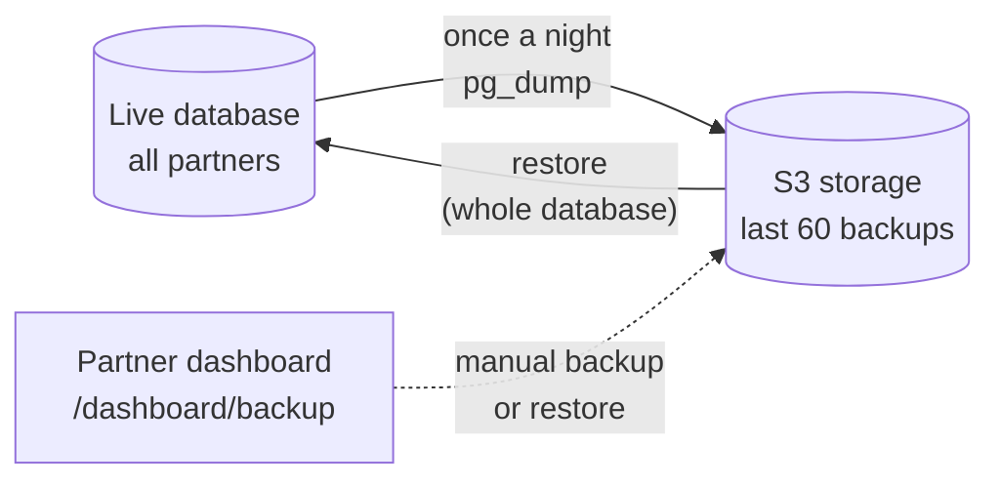
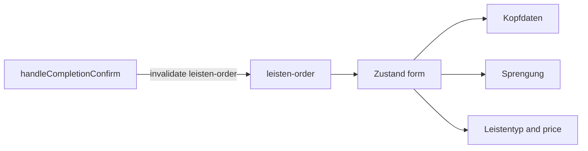

# Maßschäfte

## Contents

| Section | Topic                                                                                                       |
| ------- | ----------------------------------------------------------------------------------------------------------- |
| 1.1     | Catalogue page                                                                                              |
| 1.2     | Start popup asks for shipping too early                                                                     |
| 1.3     | Order form: customer name, user as a string on the order chain, Leisten or 3D, shipping, leather, dropdowns |
| 1.4     | Balance activity list and drafts                                                                            |
| 1.5     | Nightly database backup                                                                                     |
| 1.6     | Production number is not unique                                                                             |
| 1.7     | Shared catalogue lists should be served from Redis                                                          |
| 1.8     | Catalogue and order form show stale data                                                                    |
| 1.9     | Leather configuration of a catalogue product                                                                |
| 1.10    | Zipper: no chain type or colour                                                                             |
| 1.11    | Moving between Schaft and Boden                                                                             |
| 1.12    | Security and data integrity (backend)                                                                       |
| 1.13    | The FedEx label is stored twice                                                                             |
| 1.14    | Shipping time, delivery time, and the Lieferschein are stored twice                                        |
| 2.1     | Overview: header and progress                                                                               |
| 2.2     | Konfiguratoren cards                                                                                        |
| 2.3     | Leisten drawer                                                                                              |
| 2.4     | Halbprobe feedback                                                                                          |
| 2.5     | Page state                                                                                                  |
| 2.6     | Saving a component                                                                                          |
| 2.6.1   | Leave-page popup deletes the whole supply                                                                   |
| 2.7     | Voice recording                                                                                             |
| 2.8     | Security (backend)                                                                                          |
| 3.1     | Kopfdaten keeps the first answer and drops the saved order                                                 |
| 3.2     | Sprengung can send the short prefill                                                                        |
| 3.3     | The price stays on the start price                                                                          |
| 3.4     | One store for the form                                                                                      |

---

# Chapter 1: Custom shafts

Route: `/dashboard/custom-shafts`

## 1.1 Catalogue page

The page is clear and easy to use. Everything the user needs is on one screen. How the list is loaded is covered in 1.8.

## 1.2 Start popup asks for shipping too early

The first popup decides how production starts.

**Current behaviour**

- **3D-Modell hochladen**: one click, and the order form opens.
- **Physischer Leisten**: the popup continues and asks for the shipping of the last (combined shipment, label, pickup, date, address) before the user has seen the order.

**Expected behaviour**

The popup only asks how production starts. Shipping moves into the order form, for example as a sidebar (see 1.3.4).

**Code**

- Partner dashboard: `components/CustomShafts/NewSchaftErstellungModal.tsx`

## 1.3 Order form

Route: `/dashboard/custom-shafts/details/[id]`. Six separate points.

### 1.3.1 The customer box shows an id instead of a name

**Current behaviour**

The box shows the customer id (`cmr0na6ef000bdzvwcd1vpbnl`). When no name is passed, the form uses the id as the display name.

**Expected behaviour**

- A name is required. If there is no name, the box shows the address. The id is never shown.
- The customer is stored as `vorname` and `nachname`. One **name** field is enough, and the user types one name. The id stays in the database.

**Code**

- Partner dashboard: `app/(dashboard)/dashboard/custom-shafts/details/[id]/page.tsx:626` (`name: urlName || urlId`) and `:737` (`name: fallbackName || id`)
- Backend: `prisma/customer.schma.prisma:16–17` (`vorname`, `nachname`, both optional)

### 1.3.2 The user on the order chain is a string

Halbprobenerstellung, then Massschafterstellung, then Bodenkonstruktion are one chain. They are linked by the internal parent relation `parent_custom_shafts_id`.

**Current behaviour**

The person is a foreign key `customerId` to `customers.id`. A name that is not a registered customer is stored separately as `other_customer_name` and `customerName`.

**Expected behaviour**

The user on this chain is one string. That string is the name, and it belongs to the order through the parent relation, so Massschafterstellung and Bodenkonstruktion read the same user string from the parent order.

**Code**

- Backend: `prisma/admin-order.schma.prisma:104` (`customerId`) and `:140` (`customer` relation to `customers`)
- Backend: `prisma/admin-order.schma.prisma:102` (`other_customer_name`), `:132` (`customerName`)
- Backend: `prisma/admin-order.schma.prisma:177–179` (`parent_custom_shafts_id`, `child_custom_shafts`)

### 1.3.3 Leisten or 3D cannot be changed on the form

**Current behaviour**

The choice between a physical last and a 3D upload is made in the start popup. To change it, the user has to go back and start again.

**Suggestion**

Let the user switch between physical last and 3D directly on the order form.

**Code**

- Partner dashboard: `details/[id]/page.tsx:277` (`isFrom3DUpload = source === '3dupload'`, read from the URL)

### 1.3.4 Shipping belongs on the order form

**Expected behaviour**

Shipping is managed on the order form, not in the start popup. While **Show prices** is off (during the customer consultation), the shipping part stays hidden. The user can open the order later and edit the shipping there.

### 1.3.5 Leather areas are hard to fill

This step can feel complicated for a normal partner. It should be simpler.

**Code**

- Partner dashboard: `components/CustomShafts/LeatherColorSectionModal/index.tsx`

### 1.3.6 In English, a dropdown shows every option at once

**Current behaviour**

In English, and in every language other than German, a dropdown does not open as a list. All options are drawn side by side inside the closed field, so no single selected value is visible. This affects CAD-Modellierung, Verschluss, leather, and the other dropdowns on this form.

**Expected behaviour**

A closed dropdown shows the one selected value. The other options appear only when it is opened, one below the other.

## 1.4 Balance activity list

The page works. Its logic was built for transactions, and today it is used to track orders.

**Suggestion**

Rebuild the logic around the order:

- Clicking an order opens its details.
- The user can edit an order until the admin confirms it.
- Shipping is managed in a sidebar: cancel a FedEx label, add or remove a shipment group.

These changes are small. The page design also needs a UI/UX review.

**Code**

- Partner dashboard: `app/(dashboard)/dashboard/_components/FeetF1rstBalance/AktivitatTable.tsx`

### 1.4.1 A draft cannot be deleted

**Current behaviour**

An order can be cancelled only after it is sent ("Order received"). A draft has no delete option, so unused drafts stay in the list.

**Suggestion**

Let the user delete their own drafts and restore them later, the same way the admin restores orders from the Trash.

## 1.5 The database is backed up once a night

|                           |                                                                                                                   |
| ------------------------- | ----------------------------------------------------------------------------------------------------------------- |
| When                      | Daily, `0 7 * * *` in `Asia/Dhaka`. That is 03:00 in Germany in summer and 02:00 in winter.                       |
| How                       | `pg_dump` of the whole database, uploaded to S3                                                                   |
| Kept                      | The last 60 backups (about two months)                                                                            |
| Manual backup and restore | Partner dashboard, `/dashboard/backup`. A restore first takes a safety snapshot, then replaces the live database. |

**Risks**

- A failed backup is only written to the server log. Nobody is notified.
- The day's work is saved once, at night. A draft created and deleted on the same day never reaches a backup and cannot be recovered.
- Data older than 60 backups can no longer be restored.
- Every partner account can start a restore. The restore drops the whole `public` schema, so one partner's restore resets the data of all partners. Restore should be admin-only.

**Code**

- Backend: `cron/database_backup.ts:14` (`KEEP_LAST_BACKUPS = 60`), `:134` (`pg_dump`), `:217–226` (schedule and timezone), `:24` (`logErr`, console only)
- Backend: `module/v2/backup/restore.service.ts:168` (safety snapshot before a restore), `:198` (`DROP SCHEMA IF EXISTS public CASCADE`)
- Backend: `module/v2/backup/backup.routes.ts:63–64` (`POST /:id/restore`, `verifyUser("PARTNER")`)

## 1.6 Production number is not unique

**Current behaviour**

The production number is the partner prefix plus the last three digits of the order number. The full order number is not kept.

| Order number | Production number (prefix AB) |
| ------------ | ----------------------------- |
| 10100        | AB100                         |
| 11100        | AB100                         |

Both end in `100`, so both become `AB100`. The same partner gets a repeated production number every 1000 orders (`10000` and `11000` are both `AB000`). The column has no unique rule, so two orders can share one number, and a search or a factory sheet can open the wrong order.

**Code**

- Backend: `module/v2/admin_order_transitions/admin_order_transitions.controllers.ts:61–74` (`buildProductionNumber`, `digits.slice(-3).padStart(3, "0")`). The comment above it already says "Not unique".
- Backend: `prisma/admin-order.schma.prisma:270` (`production_number String?`, no `@unique`)

## 1.7 Shared catalogue lists should be served from Redis

**Current behaviour**

The Digitale Farbkarte is the same list for every partner. Each time it opens, the backend reads it from the database. The lists below work the same way. None of them changes per order.

| What the user sees               | Table                                                                                  | Read by                                                                                |
| -------------------------------- | -------------------------------------------------------------------------------------- | -------------------------------------------------------------------------------------- |
| Digitale Farbkarte               | `digital_color_category`, `digital_color` (`prisma/settings.schma.prisma:236`, `:245`) | `module/v3/digital_color/digital_color.controllers.ts:70`, `:326`                      |
| Shoe catalogue                   | `maßschaft_kollektion` (`prisma/admin-order.schma.prisma:11`)                          | `module/v1/admin_order/custom_shafts.controllers.ts:596` (`getAllMaßschaftKollektion`) |
| Soles                            | `sole_item` (`admin-order.schma.prisma:1050`)                                          | `module/v1/admin_order/sole_catalogue/sole_catalogue.controllers.ts:410`               |
| Frames                           | `frame_item` (`admin-order.schma.prisma:1106`)                                         | `module/v1/admin_order/frame_catalogue/frame_catalogue.controllers.ts:351`             |
| Working days and production cost | `custom_shafts_delivery_dates` (`admin-order.schma.prisma:617`)                        | `module/v1/admin_order/delivery_dates/delivery_dates.controllers.ts:123`               |
| Holidays                         | `holyday_and_vacation` (`admin-order.schma.prisma:628`)                                | `delivery_dates.controllers.ts:490`                                                    |
| Shipping prices                  | `shipping_pricing` (`admin-order.schma.prisma:696`)                                    | `module/v3/admin_order/shipping_pricing/shipping_pricing.controllers.ts:91`            |

**Expected behaviour**

These lists are served from Redis. The database is written only when an admin adds or changes an entry, and that write refreshes the Redis key. The backend already has a Redis client (`config/redis.config.ts`).

Order data stays in the database: `custom_shafts`, its files, status history, feedback, invoices, shipping, chat, and `custom_models`. Per-partner data stays there too: favourites (`maßschaft_kollektion_favorite`) and access limits (`maßschaft_kollektion_reduse_access`).

## 1.8 Catalogue and order form show stale data

Routes: `/dashboard/custom-shafts` and `/dashboard/custom-shafts/details/[id]`.

The screens work, but the same list and the same order are kept in several places. A filter change, a reload, or a save can show old data until the page is opened again. Clinical Assistant has the same problem (2.5).

**Catalogue** (`app/(dashboard)/dashboard/custom-shafts/page.tsx`)

- `useCustomShafts` fetches inside `useEffect` and keeps the result in `useState` (`hooks/customShafts/useCustomShafts.ts:42–80`).
- The page copies the result into a second list, `allFetchedItems` (`page.tsx:110–122`), and filters it again. The API has already filtered it.
- **Mehr anzeigen** and a notification deep link do not request the model they need. They increase `currentPage` until it appears (`page.tsx:124–154`).
- A change of gender, category, or search clears the list and starts again at page 1 (`page.tsx:156–163`).

**Order form** (`app/(dashboard)/dashboard/custom-shafts/details/[id]/page.tsx`, 4027 lines)

Each field is its own `useState`. The same order is also kept in three other places:

| Place                             | What it keeps                                                       |
| --------------------------------- | ------------------------------------------------------------------- |
| URL                               | Customer, draft flag, and every shipping field (`page.tsx:160–206`) |
| `localStorage` / `sessionStorage` | The form draft (`lib/customShaftsOrderFlowDraftStorage.ts`)         |
| `CustomShaftDataContext`          | A third copy, passed on to the Bodenkonstruktion page               |

- Customer data is filled from the URL, from the linked Massschuh order, and from `getParentOrderInfo`. These three can overwrite each other.
- `useSingleCustomShaft` is another `useEffect` without a cache (`hooks/customShafts/useSingleCustomShaft.ts`). Opening the same model again fetches it again.
- The same form is copied in `custom-shafts/product-order/[id]/page.tsx` (2254 lines). A fix on one page does not reach the other.

**Effects**

- The list and the "load more" counter can disagree, so the page walks through API pages while the user waits.
- A filter always starts from page 1, even for a list that was just loaded.
- After a reload, the form can be a mix of the URL, `localStorage`, and the server draft.
- Shipping lives in the URL, so the form cannot treat it as normal order data.
- A save updates the context, the URL, and the draft storage by hand. If one is missed, Bodenkonstruktion or Balance shows the old order.

**Recommended approach**

TanStack Query for server data, with one cache key shared by the catalogue, the details page, and the product-order page:

| Data                                | Query key                                               |
| ----------------------------------- | ------------------------------------------------------- |
| Catalogue pages                     | `['custom-shafts', { search, gender, category, sort }]` |
| One model                           | `['custom-shaft', shaftId]`                             |
| The order or draft                  | `['custom-shaft-order', orderId]`                       |
| Other shoe orders for this customer | `['sync-orders', customerId, 'Massschafterstellung']`   |

Zustand for the form while the user is typing: one object, not one `useState` per field. `localStorage` is only a backup if the tab closes. The URL keeps only the model id, the order id, and the customer id.

Saving a draft or sending the order invalidates `custom-shaft-order`, so the details page, Bodenkonstruktion, and Balance read the same data. This should be done before further UI work on the popup and the leather step.

## 1.9 Leather configuration of a catalogue product

The admin product list and the leather map are on different pages. The user never sees the leather map when applying the catalogue finish.

**Admin product list:** `/dashboard/upload-product`

The list shows name, price, height, and gender. The pencil opens the full product form at `/dashboard/add-products?id=...`, where the leather map is one step inside.

**Leather map:** Ledertyp, colour name, and the areas assigned on the shoe image.

**Expected behaviour (admin)**

The product list opens the leather map directly, and the admin edits it there.

**Applying the catalogue finish (partner)**

On the order form the user presses **Ausführung wie im Katalog**. The dialog only asks whether Material & Ausführung should be filled from the saved data. It does not show the leather types, the colours, or the areas.

**Expected behaviour (partner)**

The dialog shows what will be copied, using the same leather map as the admin product, so the user can check it before pressing OK.

**Code**

- Admin dashboard: `src/app/(dashbaord)/dashboard/upload-product/page.jsx:443` (pencil opens `add-products?id=`)
- Admin dashboard: `src/components/dashboard/AddProducts/LeatherColorSectionModal.jsx`
- Partner dashboard: `details/[id]/page.tsx:3892–3918` (dialog **Auto Fill bestätigen**), `:2747` (`applyAutoFillFromMassschafterstellung`)
- Backend: `prisma/admin-order.schma.prisma:35–36` (`Massschafterstellung_json1`, `ledertyp_image` on `maßschaft_kollektion`)

## 1.10 Zipper: no chain type or colour

The zipper modal on the order form. The user picks a side and draws on the shoe.

**Current behaviour**

| On the screen                         | Stored as                        |
| ------------------------------------- | -------------------------------- |
| Inside, Outside, or Both sides        | `zipper_position`                |
| The red drawing                       | `zipper_image`                   |
| Extra zipper, yes or no, with a price | `zipper_extra` on the order JSON |

Chain type and zipper colour are not on this screen. They are also not in the order JSON.

**Expected behaviour**

A shoe zipper is ordered by chain type and colour, not only by its position. Chain type is coil or metal, and colour is the tape colour. Both fields belong on this screen next to the position, so the factory sees them together with the drawing.

**Code**

- Partner dashboard: `components/CustomShafts/ZipperPlacementModal.tsx`
- Partner dashboard: `utils/customShoeOrderHelpers.ts:90–91` (`zipper_extra`, `zipper_position`)
- Backend: `prisma/admin-order.schma.prisma:31` (`is_zipper` on the catalogue product), `:123` (`zipper_image` on `custom_shafts`)

## 1.11 Moving between Schaft and Boden

When the Schaft is finished, the dialog shows the customer, the product, **Weiter ohne Boden** (Further without a bottom), and **Boden konfigurieren** (Configure floor).

**Expected behaviour**

The user can move between Schaft and Boden in both directions. Today **Boden konfigurieren** leaves the Schaft, and there is no matching way back.

### 1.11.1 Going back from Boden repeats the first page load

The Bodenkonstruktion page is `/dashboard/massschuhauftraege-deatils/2`. Its back arrow is `router.back()`.

**Current behaviour**

The Schaft page mounts again, so everything that runs on its first open runs again:

| Repeated on return                                                                                                                                                                                  | Partner dashboard           | Backend                                                                       |
| --------------------------------------------------------------------------------------------------------------------------------------------------------------------------------------------------- | --------------------------- | ----------------------------------------------------------------------------- |
| The model is loaded again (`useSingleCustomShaft`)                                                                                                                                                  | `details/[id]/page.tsx:361` | `GET /custom_shafts/mabschaft_kollektion/:id`                                 |
| `getSynchronousOrders` runs again and reopens the "other Massschafterstellung orders" popup. Closing it is remembered only in memory (`syncOrdersDismissedForCustomerRef`), which is lost on mount. | `page.tsx:665–700`          | `module/v2/shoe_orders/synchronous_order/synchronous_order.controllers.ts:20` |
| `getParentOrderInfo` runs again when the Schaft was opened from a sample or feedback                                                                                                                | `page.tsx:801`              | `module/v1/admin_order/feedback/feedback.controllers.ts:1628`                 |
| For Massschafterstellung or Komplettfertigung, `getMassschuheOrder` runs again and reopens the start popup (`NewSchaftErstellungModal`) when the URL has no `source`, `type`, or shipping choice    | `page.tsx:1282–1671`        | `GET` single Massschuh order                                                  |
| A notification reopens **Auto Fill bestätigen** (`getSingleNotification`)                                                                                                                           | `page.tsx:2778–2880`        | —                                                                             |

**Expected behaviour**

Returning keeps the Schaft as the user left it. These calls and popups have already happened.

**Suggestion (light)**

From the Boden page, the user could edit the Schaft in a sidebar or a popup. This only makes the edit easier. It is not meant to make the screen look more professional.

### 1.11.2 A 3D order cannot configure the Boden

**Current behaviour**

For a 3D order, **Boden konfigurieren** looks like a normal next step. The block appears only after the click, as a second popup: "Bestellung nicht möglich".

**Expected behaviour**

The warning appears on this dialog before the click, and **Boden konfigurieren** does not look available. **Weiter ohne Boden** remains the way to finish a 3D order.

**Code**

- Partner dashboard: `components/CustomShafts/ConfirmationModal.tsx:308–311` (check after the click), `:754–784` (the "Bestellung nicht möglich" popup)
- Partner dashboard: `details/[id]/page.tsx:3822` (redirect to `massschuhauftraege-deatils/2`)

## 1.12 Security and data integrity (backend)

All paths are in `feetf1rst-crm-new`. No global login middleware runs before the routers (`app.ts:141–144`), so each route needs its own `verifyUser`.

### 1.12.1 Routes without login

These routes have no `verifyUser`, or have it commented out. They are not QR-code links, so they should require login.

| Route                                                                    | What it does                                                         | Code                                                                          |
| ------------------------------------------------------------------------ | -------------------------------------------------------------------- | ----------------------------------------------------------------------------- |
| `DELETE /v1/massschuhe-order/delete-all`                                 | Deletes every Massschuh order of all partners and their files        | `module/v1/massschuhe_order/massschuhe_order.routes.ts:87`                    |
| `GET /v3/admin-order/get-all-orders`                                     | Lists all `custom_shafts` orders of all partners                     | `module/v3/admin_order/admin_order.routes.ts:18`                              |
| `GET`/`POST /v3/admin-order/get-child-list`                              | Returns child orders by id                                           | `admin_order.routes.ts:25`, `:32`                                             |
| `GET /v3/admin-order/get-all-partner`                                    | Lists partner business names                                         | `admin_order.routes.ts:39`                                                    |
| `GET /v1/custom_shafts/treack/get-custom-shafts-status-history/:orderId` | Status history of one order (`verifyUser` commented out)             | `module/v1/admin_order/treack/treack.routes.ts:187–191`                       |
| `DELETE /v2/shoe-orders/remove-file/:fileId`                             | Deletes an order file and its S3 object (`verifyUser` commented out) | `module/v2/shoe_orders/shoe_orders.routes.ts:187–191`                         |
| `DELETE /v1/custom_shafts/feedback/feedback-images/delete`               | Deletes feedback images                                              | `module/v1/admin_order/feedback/feedback_images/feedback_images.routes.ts:29` |

These routes are public on purpose, because a phone opens them from a QR code: Halbprobe images (`module/v2/shoe_orders/halbprobe_images/halbprobe_images.routes.ts:17`, `:24`), feedback image upload and list (`feedback_images.routes.ts:18–22`, `:36`), and the barcode and production-sheet links (2.8). On them the order id is the only key. A signed token with an expiry date in the QR link would be safer than the plain id.

### 1.12.2 The order is not checked against the user

These routes require login, but the handler loads the order by id only. It never checks that `partnerId` belongs to the logged-in user, so any partner can read or change another partner's order if they know the id.

| Route                                                       | Handler and code                                                                                                   | Effect                                                    |
| ----------------------------------------------------------- | ------------------------------------------------------------------------------------------------------------------ | --------------------------------------------------------- |
| `GET /v1/custom_shafts/get/:id`                             | `getSingleCustomShaft`, `custom_shafts.controllers.ts:5115` (`findUnique({ where: { id } })` at `:5128`)           | Reads the order with customer name, email, phone          |
| `GET /v1/custom_shafts/treack/get-custom-shafts/:partnerId` | `getCustomShaftsByPartnerId`, `treack/treack.controllers.ts:580` (filters by the `partnerId` from the URL, `:605`) | Lists another partner's orders                            |
| `PATCH /v1/custom_shafts/update-status/:id`                 | `updateCustomShaftStatus`, `custom_shafts.controllers.ts:5418` (`findUnique` at `:5486`)                           | Changes `status`, `last_status`, `order_status`           |
| `PATCH /v1/custom_shafts/update-payment-status`             | `updatePaymentStatus`, `custom_shafts.controllers.ts:6522` (`findMany({ where: { id: { in } } })` at `:6550`)      | Sets Paid / Unpaid on any order                           |
| `PATCH /v1/custom_shafts/update-admin-order/:id`            | `updateAdminOrder`, `custom_shafts.controllers.ts:7606` (`findUnique` at `:7751`)                                  | Changes `production_number`, production and shipping cost |
| `DELETE /v1/custom_shafts/delete/:id`                       | `deleteCustomShaft`, `custom_shafts.controllers.ts:6675`                                                           | Deletes the order and its children                        |

The routes are in `module/v1/admin_order/custom_shafts.routes.ts:210–212`, `:221–223`, `:254–256`, `:265–267`, `:330–332`. All of them allow `PARTNER`, `ADMIN`, and `EMPLOYEE`.

Payment status, `production_number`, and production cost are admin decisions. Today a partner token can change them, even on the user's own order. These handlers should be admin-only, and the others should add `partnerId: req.user.id` to the `where`.

`updateAdminOrderAfterDraft` already does the check for a partner (`custom_shafts.controllers.ts:7994–8000`), so the same pattern can be reused.

### 1.12.3 The price comes from the browser

The order create stores the `totalPrice` that the browser sends (`custom_shafts.controllers.ts:2346`, `totalPrice: totalPrice ? parseFloat(totalPrice) : null`). A shipping cost sent by the browser also wins over the server price (`:2307–2324`, `explicitShippingCost1 ?? autoShippingCost1`). The same applies on a draft update (`:8098–8110`). This value goes into billing (`finalizeCustomShaftOrderBilling`) and the balance.

**Expected behaviour**

The backend calculates the price from the catalogue, the options, and `shipping_pricing`, and ignores the browser value, or rejects the order when the two differ.

### 1.12.4 Saving a draft can delete the order's own images

`updateAdminOrderAfterDraft` (`custom_shafts.controllers.ts:7939`) goes through each file field. When the field is sent, it deletes the old S3 file first and then stores the new value (`:8043–8049`):

- It does not compare the old and the new URL. The partner dashboard re-sends the existing S3 URL when the image is unchanged (`utils/customShoeOrderHelpers.ts:446–464` for `zipper_image` and `paintImage`, `:396–404` for `image3d_1` and `image3d_2`). If the same URL comes back, the file is deleted while the order still points to it.
- The list includes `custom_models_image` (`:8012`), which is a column of `custom_models` (`prisma/admin-order.schma.prisma:650`), not of `custom_shafts`. When it is sent (custom model draft, `customShoeOrderHelpers.ts:414–424`), Prisma rejects the update. The old files of the other fields are already deleted at that point, and the error path removes only the new uploads (`:8331–8334`).

**Expected behaviour**

Delete the old file only when the URL really changed, and only after the database update has succeeded. Write `custom_models_image` to `custom_models`.

### 1.12.5 Order number can be repeated

`generateNextCustomShaftOrderNumber` (`module/v2/admin_order_transitions/admin_order_transitions.controllers.ts:41–54`) takes `MAX(orderNumber) + 1` per partner. `orderNumber` is only indexed, not unique (`prisma/admin-order.schma.prisma:100`, `:371`). Two orders sent at the same moment can get the same number. Because the production number is built from it (1.6), it is repeated too.

**Expected behaviour**

A unique rule on `(partnerId, orderNumber)` and a database sequence or a lock for the next number.

### 1.12.6 Uploads

- No file type check. Multer only limits the size (100 MB) and stores the type the browser declares (`config/multer.config.ts:14–27`).
- On `PATCH /v1/custom_shafts/update-admin-order-after-draft/:id`, `upload.fields(...)` runs before `verifyUser` (`custom_shafts.routes.ts:342–357`). A request without login still uploads its files to S3 before it is rejected.

**Expected behaviour**

An allow-list of file types per field (images, PDF, STL/OBJ for 3D), and `verifyUser` before `upload` on every route.

## 1.13 The FedEx label is stored twice

The same three fields exist on the order and on the shipping row.

| Field | On the order `custom_shafts` | On the shipping row `custom_shafts_shipping` |
| ----- | ---------------------------- | -------------------------------------------- |
| Label PDF | `pickup_label` (`admin-order.schma.prisma:278`) | `pickup_label` (`:732`) |
| When the label was set | `label_created_at` (`:279`) | `label_created_at` (`:737`) |
| FedEx tracking | `fedex_tracking_number` (`:280`) | `fedex_tracking_number` (`:741`) |

The order columns are the old copy. The shipping row is the new copy. A new label does not replace the old columns, and a cancel then clears the old columns anyway.

**Current behaviour**

- A FedEx label is saved only on `custom_shafts_shipping` (`utils/fedex.service.ts:306–314` and `:534–542`). A manual upload does the same (`module/v1/admin_order/treack/treack.controllers.ts:2141–2150`).
- The old admin update still writes `pickup_label` on the order (`module/v1/admin_order/custom_shafts.controllers.ts:7774–7804`, `PATCH /custom_shafts/update-admin-order/:id`).
- The order response returns both. The order field is `pickup_label` (`module/v1/massschuhe_order/admin_order/admin_order.controllers.ts:4122`). The shipping row is `custom_shafts_shipping[].pickup_label` (`:4222–4228`). After a new label, the shipping row has the new PDF and the order field still has the old one.
- Cancel and void then set the order columns to null (`module/v3/admin_order/admin_to_paerner_shipping/shipping.controllers.ts:805–808`, `module/v1/admin_order/custom_shafts.background.service.ts:1641–1667`) and delete the S3 file from both URLs (`:1657–1676`). The new cancel overwrites the old copy. When the two URLs differ, both files are deleted.

**Old code still next to the new code**

A lot of the earlier shipping code is still in these files. Some of it no longer saves the label. For the rest, the code does not say whether that path is still the one in use.

- The schema calls the link `custom_shafts_shipping.custom_shafts_id` legacy, and says new code uses `custom_shafts.custom_shafts_shipping_id` (`admin-order.schma.prisma:282–294`). Group remove still writes the old `custom_shafts_id` (`module/v3/admin_order/paerner_to_admin_shipping/shipping.controllers.ts:790–792`). Cancel still finds the orders by the new id, the old id, and `package_group_id` together (`admin_to_paerner_shipping/shipping.controllers.ts:773–780`).
- `custom_shafts_shipping_backup` is still read and written when a partner-to-admin group changes (`paerner_to_admin_shipping/shipping.controllers.ts:780–796`). Another handler in the same file says that JSON field is not used (`:1536–1538`).

**Expected behaviour**

The label, the time, and the tracking number live only on `custom_shafts_shipping`. The order does not keep a second copy. One link, `custom_shafts_shipping_id`, is how an order finds its shipping row.

## 1.14 Shipping time, delivery time, and the Lieferschein are stored twice

The same pattern as 1.13. The order keeps a copy, and the shipping row keeps another. A later write updates one of them.

| What | On the order `custom_shafts` | On the shipping side |
| ---- | ---------------------------- | -------------------- |
| Sent at | `shipping_time` (`admin-order.schma.prisma:224`) | `custom_shafts_shipping.shipping_time` (`:745`) |
| Delivered at | `delivered_at` (`:241`) | `custom_shafts_shipping.delivered_at` (`:781`) |
| Admin-to-partner type | `shipping_type2` (`:215`) | `custom_shafts_shipping.shipping_type` (`:714`) |
| Lieferschein PDF | — | `custom_shafts_shipping.delivery_note` (`:766`) and `shipping_delivery_note.delivery_note_pdf` (`:818`) |
| Lieferschein number | `delivery_note_number` (`:300`) | `shipping_delivery_note.delivery_note_number` (`:819`) |

**Current behaviour**

- The grouped-shipping cron writes `shipping_time` on the order and on the shipping row in one transaction (`cron/admin_to_partner_grouped_shipping.ts:207–224`). Cancel then clears `shipping_time` on the order only (`module/v3/admin_order/admin_to_paerner_shipping/shipping.controllers.ts:801–803`). The shipping row keeps its time (`:789–799`).
- The same cron copies the service into `shipping_type2` on the order and into `shipping_type` on the shipping row (`cron/admin_to_partner_grouped_shipping.ts:661–673`). Sending the label does it again (`admin_to_paerner_shipping/shipping.controllers.ts:1990–2002`).
- The FedEx track cron writes `delivered_at` on the shipping row, then copies that time onto the orders (`cron/fedex.custom-webhook.ts:204`, `:222–225`). Marking the group Ausgeführt writes `delivered_at` on the orders only (`module/v1/admin_order/custom_shafts.controllers.ts:6489–6499` and `admin_to_paerner_shipping/shipping.controllers.ts:2489–2495`). The shipping row is not updated there, so the two times can differ.
- The Lieferschein PDF from the shipping cron stays on `custom_shafts_shipping.delivery_note`. The later delivery-note create stores another PDF on `shipping_delivery_note.delivery_note_pdf` (`module/v3/admin_order/delivery_note/delivery_note.controllers.ts:419–422`). The screen reads the new PDF, and if that is empty it falls back to the old one (`module/v3/admin_order/deliverd_group/deliverd_group.controllers.ts:366–368`).
- The Lieferschein number is written on the note and again on each order (`delivery_note.controllers.ts:421–422` and `:441–445`, and again at `:990–998`).

The customer name is the same kind of copy, already in 1.3.2 (`customerId`, `other_customer_name`, `customerName`). Internal / External is the same kind of copy, already in 2.6 (`component_type` in two tables).

**Expected behaviour**

`shipping_time`, `delivered_at`, and `shipping_type` live on `custom_shafts_shipping`. The Lieferschein PDF and its number live on `shipping_delivery_note`. The order keeps the link, not a second copy.

---

# Chapter 2: Clinical Assistant (Massschuhauftrag)

Route: `/dashboard/scanning-data/[id]?form=clinical_assistant`

The user builds one custom shoe here, step by step: Befund, Versorgungsplan, Leisten (Leistenerstellung), Bettung (Bettungserstellung), Schaft (Massschafterstellung), Boden (Bodenkonstruktion), Halbprobe (Halbprobenerstellung), Auftrag, and Abholung.

Each part is stored as a component with a category from `components_catagory` (backend `prisma/clinica-assistant.schma.prisma:307`). Stale data on the page is covered in 2.5. What a save actually writes is covered in 2.6.

## 2.1 Overview: header and progress do not match

The flow is good, but:

- The customer header shows dashes instead of real data.
- The two progress numbers disagree: "1 von 2" here, "0 von 4" in Konfiguratoren.
- There are too many buttons, so the next step is not clear.

## 2.2 Konfiguratoren cards are too small

The cards are too small for what they show: status, icons, employee, warnings, and production type.

**Suggestion**

A full-width list in the real workflow order: Leistenerstellung → Halbprobenerstellung → Massschafterstellung / Bodenkonstruktion → Auftrag → Abholung.

## 2.3 Leisten drawer can show stale data

The layout is fine. The data in the drawer does not always match the order. This is fixed by the state management in 2.5.

## 2.4 Halbprobe feedback is hard to read

The Halbprobenerstellung modal needs a UI review, so the feedback is clearer and easier to read.

## 2.5 The page keeps stale data until reload

**Current behaviour**

- Draft data (per customer) and order data (per order) are loaded in two different ways.
- State is plain React `useState` and `useEffect` inside very large components.
- The page often shows old data until reload, and the flow between steps breaks after regular updates.

**Recommended approach**

TanStack Query for server data (one cache per order, refreshed after each save) and one Zustand store for the order. The backend decides which steps are allowed.

**Code**

- Partner dashboard: `app/(dashboard)/dashboard/_components/Scanning/ClinicalAssistant.tsx` (3837 lines), `components/clinical/CarePlan.tsx` (3083 lines), `components/clinical/ComponentConfigurator.tsx` (3294 lines)

## 2.6 Saving a component writes inconsistent data

Four issues change what is stored:

- **Duplicates.** There is no rule "one component per category per order", so a double click creates a second row. The page shows only one.
- **Two sources for Internal / FeetF1rst.** The production type is stored in two tables, and they can disagree.
- **One save confirms the whole supply.** Saving one active component sets `order_conform`, without the signature buttons.
- **Public barcode link.** `GET /v4/clinical_assistant/order_components/barcode-scan` has no login. Anyone with the link can add a scan to that order.

**Full list**

| #   | Issue                                                                                       | Code                                                                                                                                                 |
| --- | ------------------------------------------------------------------------------------------- | ---------------------------------------------------------------------------------------------------------------------------------------------------- |
| 1   | `getOrderComponents` is called from 9 places, once per component and again after every save | Partner dashboard `components/clinical/ComponentConfigurator.tsx:733, 773, 814, 847, 885, 915, 960, 1043, 1078`                                      |
| 2   | The Leisten form is read every 400 ms while open                                            | Partner dashboard `ComponentConfigurator.tsx:1232` (`setInterval(tick, 400)`)                                                                        |
| 3   | Three files over 3000 lines                                                                 | `ComponentConfigurator.tsx`, `CarePlan.tsx`, `ClinicalAssistant.tsx`                                                                                 |
| 4   | No chat with FeetF1rst on External cards; the user has to open the Balance page             | Partner dashboard `ComponentConfigurator.tsx`                                                                                                        |
| 5   | The live update `shoe-order-steps` is sent only from the QR / barcode link                  | Backend `module/v4/clinical_assistant/order_components/order_sheet/order_sheet.controllers.ts:105`                                                   |
| 6   | On a live update, only the step list reloads, not the cards                                 | Partner dashboard `components/clinical/CarePlan.tsx:698`                                                                                             |
| 7   | Saving one component confirms the whole order (`order_conform`)                             | Backend `module/v4/clinical_assistant/order_components/order_components.controllers.ts:114` (`markShoeOrderConform`), called at `:1633`              |
| 8   | No unique rule for one component per category, so duplicates are possible                   | Backend `prisma/clinica-assistant.schma.prisma:263–265` (`clinica_assistant_order_components`: index only, no `@@unique([shoe_order_id, catagory])`) |
| 9   | Same for active components                                                                  | Backend `clinica-assistant.schma.prisma:344–345` (`active_components`: index only)                                                                   |
| 10  | Internal / External is stored in two tables that can disagree                               | Backend `clinica-assistant.schma.prisma:198` and `:333` (`component_type` in both tables)                                                            |
| 11  | The barcode link has no login                                                               | Backend `module/v4/clinical_assistant/order_components/order_components.routes.ts:103–106` (marked PUBLIC, no `verifyUser`)                          |

### 2.6.1 Leave-page popup deletes the whole supply

**Current behaviour**

- "Entwurf" only means "order not confirmed". Components are not checked, so a supply with a running FeetF1rst order is still called a draft.
- **"Nein, löschen" deletes the whole supply**: findings, signature, insurance, notes, history, and more. There is no undo and no trash. A running FeetF1rst order is not cancelled, only unlinked.
- The wording is confusing: the question asks "keep?", and the red button says "No, delete".
- The popup does not appear on tab close or reload. If the check fails, the page simply leaves.

**Code**

- Partner dashboard: `components/clinical/ClinicalAssistantLeaveGuard.tsx:254–287` (`deleteDraftAndLeave`), `:451` (button)
- Backend: `DELETE /v4/clinical_assistant/delete-order/:order_id`, `module/v4/clinical_assistant/clinical_assistant.routes.ts:116`, handler `clinical_assistant.controllers.ts:897` (`deleteOrder`)

## 2.7 Voice recording works only in some browsers

Klinische Denkstruktur, button **Gespräch aufnehmen**.

**Current behaviour**

Recording uses the free speech recognition built into the browser. It works in Chrome and Edge, but not in every browser (for example Firefox), so some partners cannot use it.

**Suggestion**

Record the audio in the browser and send it to a speech-to-text service on the server (for example OpenAI Whisper, Deepgram, or Azure Speech). This works the same in every browser and recognises German medical terms better, but it costs per minute.

## 2.8 Security (backend)

**The order is not checked against the user.** Both handlers load the `shoe_order` by id only and never check `partnerId`. Other handlers in the same module already filter by `partnerId` (`changeComponentType`, `deleteOrderComponent`, `deleteOrder`).

- `createOrderComponents`, `module/v4/clinical_assistant/order_components/order_components.controllers.ts:1030` (`shoe_order.findUnique({ where: { id } })` at `:1163`)
- `getOrderComponents`, `order_components.controllers.ts:1993` (`findFirst({ where: { shoe_order_id, catagory } })` at `:2026`)

**Public production-sheet links.** Besides the barcode link (2.6), the production sheet can be read and its step started or ended without login. Only the order id protects it.

- `GET /v4/clinical_assistant/order_components/order_sheet/produktionsauftrag`, `order_sheet/order_sheet.routes.ts:37`
- `POST …/produktionsauftrag/change-status`, `order_sheet.routes.ts:44`. This is the call that sends the live update `shoe-order-steps` (`order_sheet.controllers.ts:105`).

**Expected behaviour**

Add `partnerId: req.user.id` to both lookups. The QR links get a signed token with an expiry date instead of the plain order id.

---

# Chapter 3: Leistenkonfigurator

Route: `/dashboard/leistenkonfigurator`

The screen is clear. The form does not have one place for its data, so a saved order does not show up first, and the price and the submit can read a different copy than the screen. The same stale-data problem is on the catalogue (1.8) and in Clinical Assistant (2.5).

**Code**

- Partner dashboard: `app/(dashboard)/dashboard/leistenkonfigurator/page.tsx`

## 3.1 Kopfdaten keeps the first answer and drops the saved order

**Current behaviour**

Two loads both fill the patient and the files:

- `loadPrefillData` calls `getLeistenkonfiguratorData(orderId, customerId)` and sets only the patient name.
- `loadHalbprobenerstellungPrefill` calls `getMassschuheOrder(customShaftsId)` and sets the patient, the STL files, the PDF, and the Leistenmaterial.

`kopfdaten.tsx` copies `initialData` once (`initialHydratedRef`). The first answer is kept. The full order that arrives second is dropped, so Patient and the 3D files stay empty even though `getMassschuheOrder` already returned them.

**Expected behaviour**

When `customShaftsId` is in the URL, only `['leisten-order', customShaftsId]` runs. The form waits for that answer, then sets Patient, Holzleisten / Plastikleisten, and the file URLs from it. `loadPrefillData` does not run beside it.

When there is no `customShaftsId`, the short prefill uses `['leisten-prefill', orderId, customerId]`.

## 3.2 Sprengung can send the short prefill

**Current behaviour**

The numbers live in the child's own `useState`. The parent never holds them. `sprengung-spitzenzugabe.tsx` applies `initialData` once (`hydratedRef`), then ignores later answers.

`loadHalbprobenerstellungPrefill` writes that data with `setInitialSprengung`. `getHalbprobenerstellungJson` and `buildFormData` do not read this state. They call `sprengungRef.current.getData()` when the user presses Weiter. If the hydrate already locked onto the short prefill, Weiter sends those short values, not the saved Halbprobe JSON.

**Expected behaviour**

Sprengung is the field `sprengungSpitzenzugabe` on the same order as 3.1. It is not a second request. Weiter reads that saved value.

## 3.3 The price stays on the start price

**Current behaviour**

The price is not stored with the form. `handlePriceUpdate` recalculates it by reading `kopfdatenRef` and `leistentypRef`, and only when Leistenmaterial or Leistentyp fires `onChange` (`handleLeistentypChange`).

After `loadHalbprobenerstellungPrefill` sets `initialLeistentyp`, nothing calls `handlePriceUpdate`. The button stays on the start price (199,99 €) until the user clicks a last type. `getHalbprobenerstellungJson` then saves that price into `Halbprobenerstellung_json`.

**Expected behaviour**

Leistentyp and Formkonfiguration are `leistentyp` and `allgemeineOptionen` on the same order. When that order is written into the form, the price is calculated once from it, not from a later click.

Other orders for this customer stay a separate query: `['sync-orders', customerId, 'Leistenerstellung']` (`getSynchronousOrders` on the page).

## 3.4 One store for the form

**Current behaviour**

| What happens now | Function |
| --- | --- |
| Two loaders, and the first one wins | `loadPrefillData`, `loadHalbprobenerstellungPrefill` |
| Each section copies the data once and then ignores the server | hydrate effect in `kopfdaten.tsx`, `sprengung-spitzenzugabe.tsx`, `leistentyp.tsx` |
| The price and the submit read refs, not the form the user sees | `handlePriceUpdate`, `getHalbprobenerstellungJson`, `buildFormData`, `validateForm` |

**Recommended approach**

The same approach as 1.8 and 2.5. TanStack Query holds the server order. Zustand holds the form while the user is typing: Kopfdaten, Sprengung, Leistentyp, `allgemeineOptionen`, and the price.

| Data | Query key |
| --- | --- |
| The saved order | `['leisten-order', customShaftsId]` |
| The short prefill, when there is no `customShaftsId` | `['leisten-prefill', orderId, customerId]` |
| Other Leistenerstellung orders for this customer | `['sync-orders', customerId, 'Leistenerstellung']` |

One query result is written into that store. The price and the submit read the store. After `createLeistenkonfigurator` in `handleCompletionConfirm`, invalidate `['leisten-order', customShaftsId]`, so the next open shows what was saved.

