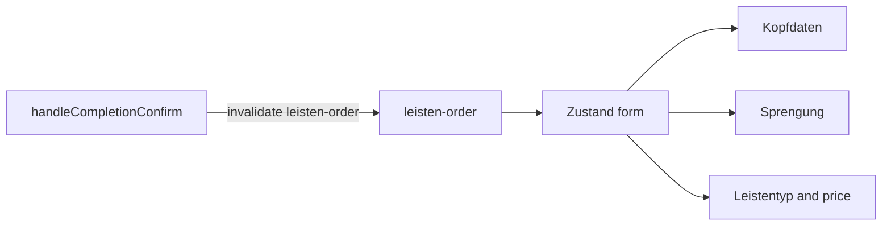

# Leistenkonfigurator

Route: `/dashboard/leistenkonfigurator`

The UI is mostly fine. It can be polished later. The work is in the functions: the form does not have one place for its data, so a saved order does not show up first, and the price and the submit can read a different copy than the screen.

Page file: `app/(dashboard)/dashboard/leistenkonfigurator/page.tsx`

---

## 1. Kopfdaten


Functions on this block: `loadPrefillData`, `loadHalbprobenerstellungPrefill`, and the hydrate effect in `kopfdaten.tsx`.

Two effects both try to fill the patient and the files.

```ts
// orderId + customerId
const response = await getLeistenkonfiguratorData(orderId, customerId);
setInitialKopfdaten({ patient: customerName });

// customShaftsId + Halbprobenerstellung
const response = await getMassschuheOrder(customShaftsId);
setInitialKopfdaten({ patient, leftStlUrl, rightStlUrl, pdfUrl, leistenmaterial });
```

`kopfdaten.tsx` copies `initialData` once (`initialHydratedRef`). The first response that arrives is kept. The full order that arrives second is dropped, so Patient and the 3D files stay empty even though `getMassschuheOrder` already returned them.

**Query:** `['leisten-order', customShaftsId]`

When `customShaftsId` is in the URL, only this query runs. `loadPrefillData` does not run next to it. The form waits for this query, then Patient, Holzleisten / Plastikleisten and the file URLs are set from that one answer.

If there is no `customShaftsId`, the short prefill uses `['leisten-prefill', orderId, customerId]`.

---

## 2. Sprengung and Modellierung


Functions on this block: `loadHalbprobenerstellungPrefill` (writes `setInitialSprengung`) and the hydrate effect in `sprengung-spitzenzugabe.tsx`.

The numbers live in the child's own `useState`. The parent never holds them. The child applies `initialData` once:

```ts
const hydratedRef = useRef(false);
useEffect(() => {
  if (!initialData || hydratedRef.current) return;
  hydratedRef.current = true;
  setFormData((prev) => ({ ...prev, ...initialData }));
}, [initialData]);
```

`getHalbprobenerstellungJson` and `buildFormData` do not read this state. They call `sprengungRef.current.getData()` at submit time. If the hydrate already locked onto the short prefill, Weiter sends those short values, not the saved Halbprobe JSON.

**Query:** same `['leisten-order', customShaftsId]`. Sprengung is a field on that order (`sprengungSpitzenzugabe`), not a second request.

---

## 3. Leistentyp, Form and price


Functions on this block: `handlePriceUpdate`, `handleLeistentypChange`, `getHalbprobenerstellungJson`.

The price is not stored with the form. It is recalculated by reading refs, and only when Leistenmaterial or Leistentyp fires `onChange`.

```ts
const handlePriceUpdate = (leistenmaterialOverride?: 'holz' | 'plastik') => {
  const kopfdatenData = kopfdatenRef.current?.getData();
  const leistentypData = leistentypRef.current?.getData();
  const calculatedPrice = basePrice + knoechelhoherLinks + knoechelhoherRechts + materialAdjust;
  setTotalPrice(calculatedPrice);
};
```

After `loadHalbprobenerstellungPrefill` sets `initialLeistentyp`, nothing calls `handlePriceUpdate`. The button stays on the start price (199,99 €) until the shop clicks a last type. `getHalbprobenerstellungJson` then saves that price into `Halbprobenerstellung_json`.

**Query:** still `['leisten-order', customShaftsId]`. Leistentyp and Formkonfiguration are `leistentyp` and `allgemeineOptionen` on that same object. When the query data is written into the form, the price is calculated once from that object, not from a later click.

Other orders for this customer stay a separate query: `['sync-orders', customerId, 'Leistenerstellung']` (`getSynchronousOrders` in the page effect).

---

## 4. What to change

| Now | Function | Replace with |
| --- | --- | --- |
| Two loaders, first one wins | `loadPrefillData`, `loadHalbprobenerstellungPrefill` | one query, `['leisten-order', customShaftsId]` |
| Each section copies data once and then ignores the server | hydrate effect in `kopfdaten.tsx`, `sprengung-spitzenzugabe.tsx`, `leistentyp.tsx` | write the query result into one form store |
| Price and submit read refs | `handlePriceUpdate`, `getHalbprobenerstellungJson`, `buildFormData`, `validateForm` | read that same store |

Zustand holds the form while the shop types: kopfdaten, sprengung, leistentyp, allgemeineOptionen, price. TanStack Query holds the server order. After `createLeistenkonfigurator` in `handleCompletionConfirm`, invalidate `['leisten-order', customShaftsId]` so the next open shows what was saved.


