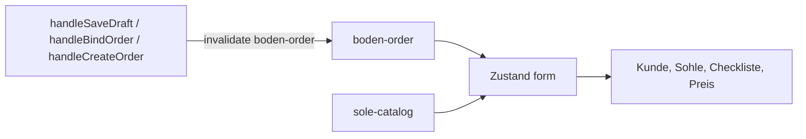

# Bodenkonstruktion

Route: `/dashboard/bodenkonstruktion`

The screen is mostly fine. The work is in the page file `app/(dashboard)/dashboard/bodenkonstruktion/page.tsx`. One order is split across many `useState` values, and the saved order is copied into those states one by one. Until that copy finishes, the sole card and the price do not match the order.

---

## 1. Kunde, Liefertermin, Sohle


Functions on this block: `applySelectedCustomer`, `loadBodenkonstruktionPrefill`, `useSoleData`, `hydrateSelectedSoleFromJson`.

`applySelectedCustomer` writes the customer into state and into the URL (`customerId`, `customerName`). Picking a customer also runs `getSynchronousOrders` and can open the link modal before the form is filled.

The saved order is loaded only inside `loadBodenkonstruktionPrefill`, and only when the URL has `customShaftsId` and `category=bodenkonstruktion`:

```ts
const response = await getMassschuheOrder(customShaftsId)
const bodenJson = JSON.parse(data.bodenkonstruktion_json)
```

The sole is not taken from that JSON directly. The function reads `selected_sole.id`, then `useSoleData` has to finish its own list. `useSoleData` calls `getSoleCatalogueList` in a loop (up to 20 pages) on every open, with no cache. Until that list arrives, the card stays on "Keine Sohle ausgewählt" even though the order already has a sole. Red borders wait on `prefillFinished` and `soleStillHydrating`, so they can show before the sole name is there.

**Queries**

| Data | Query key | Replaces |
| --- | --- | --- |
| Saved Boden order | `['boden-order', customShaftsId]` | `loadBodenkonstruktionPrefill` |
| Sole catalogue | `['sole-catalog']` | `useSoleData` |
| Other Boden orders for this customer | `['sync-orders', customerId, 'Bodenkonstruktion']` | the `getSynchronousOrders` effect |
| Delivery date | `['delivery-date', 'Bodenkonstruktion']` | `useDeliveryDateByCategory` |

`boden-order` and `sole-catalog` should both be ready before the sole card renders. The sole id from the order is matched against the cached catalogue, not against a list that is fetched again on every visit.

---

## 2. Checkliste


Functions on this block: `loadBodenkonstruktionPrefill`, `setGroup`, `runFormValidation`, `getBodenkonstruktionValidationErrors`.

Hinterkappe, Vorderkappe, Sohlenversteifung, Brandsohle, Rahmen, Absatz and the rest are not one object. `loadBodenkonstruktionPrefill` writes each part with its own setter:

```ts
setSelected((prev) => ({ ...prev, ...mergedSelected }))
setOptionInputs(optionInputsFromJson)
setTextAreas({ besondere_hinweise: hinweise })
setSohlenversteifung(...)
setSohlenaufbau(...)
setRahmen(...)
setVorderkappeSide(...)
setHinterkappeSide(...)
setHinterkappeMusterSide(...)
setBrandsohleSide(...)
setAbsatzFormConfigs(...)
setSole4Thickness(...)
setSole5Thickness(...)
setSole6Thickness(...)
```

`runFormValidation` must list every one of those states. If one setter is skipped, that card stays on the default (for example Hinterkappe "Muster liefern wir selbst") while the JSON had another value. `setGroup` only updates `selected`, so a change in Hinterkappe does not refresh Rahmen or the sole variant fields.

**Query:** the checklist is not a second request. It is `form_data_v2` and `checklist_selected` inside `['boden-order', customShaftsId]`.

---

## 3. Preis and Weiter


Functions on this block: `useBodenkonstruktionCalculations`, `handleWeiterClick`, `handleSaveDraft`, `handleRequestBindOrder`, `handleBindOrder`, `handleCreateOrder`, `prepareCustomBodenkonstruktionFormData`.

The price is `useBodenkonstruktionCalculations(selected, basePrice, rahmen, hinterkappeMusterSide, hinterkappeSide, brandsohleSide, vorderkappeSide, selectedSole)`. It updates only after those states have been set. While the sole is still hydrating, **Weiter** still shows the base **194,99 €**.

Three submit functions build the same payload:

- `handleSaveDraft` → `updateAdminOrderAfterDraft` or `createCustomBodenkonstruktion` with `is_draft=yes`
- `handleBindOrder` → update draft, then `sendOrderToAdmin`
- `handleCreateOrder` → `createCustomBodenkonstruktion`

All three call `prepareCustomBodenkonstruktionFormData`, which reads the split states again. `handleWeiterClick` and `handleRequestBindOrder` also write the price to `localStorage` (`currentBalance`) for the next page.

**Query:** after a successful save, invalidate `['boden-order', customShaftsId]`. Balance and a later open of this page then read the saved JSON, not the old `useState` defaults.

---

## 4. What to change

| Now | Function | Replace with |
| --- | --- | --- |
| Order JSON copied into many setters | `loadBodenkonstruktionPrefill` | one query, `['boden-order', customShaftsId]`, written once into the form store |
| Sole list fetched on every open | `useSoleData` | `['sole-catalog']`, shared cache |
| Validation and price read each slice | `runFormValidation`, `useBodenkonstruktionCalculations` | read the same store |
| Three submits rebuild FormData from those slices | `handleSaveDraft`, `handleBindOrder`, `handleCreateOrder` | one `prepareCustomBodenkonstruktionFormData` that reads the store, then invalidate `boden-order` |

Zustand holds the form while the shop edits: customer, selected sole, checklist, hinterkappe, rahmen, sohlenaufbau, price. TanStack Query holds the server order and the sole catalogue.


